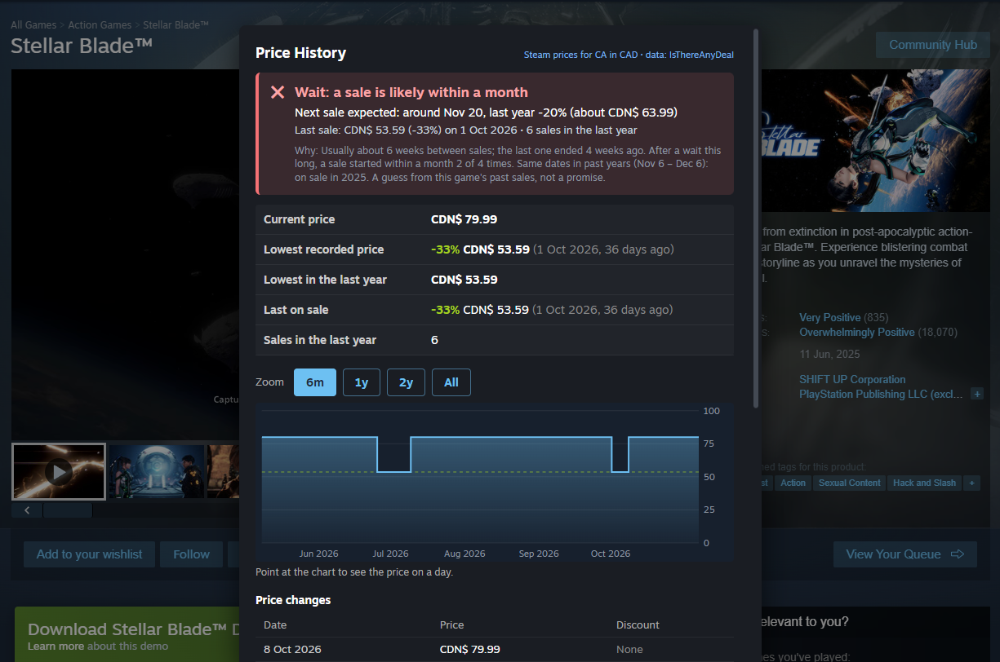

# Price History for Steam (Millennium plugin)

A [Millennium](https://steambrew.app) plugin for **desktop Steam on Windows and
Linux**. On a game's Steam store page it adds a **Price History** button (bottom
right). Clicking it opens a dialog with the game's Steam prices in your store
region's currency:

- a verdict: **Good deal**, **Normal**, **Maybe wait** or **Wait**, with a guess of
  whether a sale is likely within your **Willing to wait** time
- current price, discount and when the sale ends
- lowest recorded price, lowest in the last year, last sale, sales per year
- a price chart (6 months / 1 year / 2 years / all; point at it for the price on a day)
- the latest price changes

Price history comes from [IsThereAnyDeal](https://isthereanydeal.com) (free API
key needed); the current price comes from Steam. It's a port of my Price History
plugin for Decky Loader on the Steam Deck.



## Tested on

- Millennium 3.6.2 on Windows 11 (desktop Steam).
- Linux is expected to work (Millennium supports it and the plugin has nothing
  Windows-specific), but it hasn't been tested yet. Reports welcome.

## Install

1. Install **Millennium 3.4 or newer**: follow the steps for your OS at
   https://steambrew.app, then start Steam once.
2. Download `com.hoangpm14.price-history.star` from this repo's
   [Releases](https://github.com/hoangpm14/steam-millenium-price-history-plugin/releases)
   (or [build it yourself](#build-from-source)).
3. Exit Steam completely, then copy the file into Millennium's plugins folder:
   - Windows: `<Steam folder>\millennium\plugins\` (usually
     `C:\Program Files (x86)\Steam\millennium\plugins\`)
   - Linux: `~/.local/share/millennium/plugins/`
4. Start Steam. Steam menu → **Millennium** → **Plugins**: turn on **Price History**
   if it isn't already.
5. Add an IsThereAnyDeal API key (needed for the history; the current price works
   without one):
   1. Sign in at https://isthereanydeal.com and open https://isthereanydeal.com/apps/my/
   2. Register an app (any name) and copy its **API key**.
   3. Steam menu → **Millennium Library Manager** → **Price History** → paste the
      key → **Save key** (the plugin checks the key before saving it).
6. Open any game's store page and click **Price History** (bottom right).

The same panel has **Prices for** (region override; "Automatic" uses your Steam
store region) and **Willing to wait**.

Some regions (e.g. Vietnam, Mexico, Switzerland) have no IsThereAnyDeal history
in their own currency. There the plugin applies past sale dates and discounts to
today's full price and labels the history "estimated".

## Troubleshooting

- **Log file:** `price-history.log` in Millennium's log folder (Windows:
  `<Steam folder>\millennium\logs\`; Linux:
  `${XDG_STATE_HOME:-~/.local/state}/millennium/logs/`). Past 1 MB it moves to
  `price-history.old.log`. The `com.hoangpm14.price-history_log.log` that
  Millennium creates next to it only holds a header.
- **Problems found:** if something the plugin relies on stops working (often after
  a Steam update), it's listed at the top of the plugin's settings panel and in the log.
- **No button:** check the plugin is turned on and that Steam was fully restarted
  after copying the file.

### Reporting a problem

Open an issue at
https://github.com/hoangpm14/steam-millenium-price-history-plugin/issues with:

- what you did and what happened (a screenshot helps)
- your OS and Millennium version
- `price-history.log` (see above) and anything listed under "Problem found" in
  the plugin's settings panel

The log doesn't contain your API key, but check it before attaching it anyway.

## Privacy

- **What's sent where:** to show a game's prices, the plugin sends the game's
  Steam app ID and your store country to IsThereAnyDeal's API and to Steam's
  store API, along with what any web request carries (such as your IP address).
  Nothing else is sent, and nothing goes anywhere else. No analytics or tracking.
- **Your API key** is added by the plugin's backend (which runs on your PC, outside
  the web page), so Steam's web pages never see it. It's sent only to
  IsThereAnyDeal.
- **Where settings are stored:** in Millennium's config file
  (`<Steam folder>\millennium\config\config.json` on Windows), including the API
  key **in plain text**. Don't share that file. To remove the key, clear it in
  the plugin's settings panel and press **Save key**.
- **Cache:** answers are kept in memory for 10 minutes and are gone when Steam
  closes. The log file stays on your PC.

## Disclaimer

This is an unofficial, community-made plugin. It isn't affiliated with or
endorsed by Valve, Steam, IsThereAnyDeal or the Millennium project. Prices and
sale guesses can be wrong; the sale guess is based on a game's past sales, not
on any announcement.

## Build from source

Needs **Node.js** (LTS) and Bash: on Linux any terminal, on Windows **Git Bash**
(from [Git for Windows](https://git-scm.com)).

```bash
bash build.sh           # install npm dependencies if missing, run the checks, build dist/*.star
bash build.sh --install # also install into Millennium, restarting Steam if it's running
bash build.sh --install --plugins-dir '/path/to/millennium/plugins'  # custom destination
```

With `--install`, if Steam is running the script asks it to shut down, waits up
to 60 seconds, copies the plugin, and starts Steam again. If Steam doesn't exit
(a game or dialog is open), nothing is copied. If Steam isn't running, it copies
the plugin and leaves Steam closed. Steam is found through the registry on
Windows; on Linux the script uses `steam` from PATH, or the Flatpak
(`com.valvesoftware.Steam`). Copying into Program Files may need an
administrator terminal.

### Tests

`build.sh` runs all of these:

```sh
npm run typecheck                                # TypeScript check of the page and panel code
node tests/ffi_test.cjs                          # backend answers as decoded objects and JSON strings
luajit tests/backend_test.lua backend/main.lua   # Lua backend unit test
```

The Lua test needs **LuaJIT** on PATH (Linux: `sudo apt install luajit` or your
distro's package; Windows: `winget install DEVCOM.LuaJIT`, then open a new
terminal). Without it, the build prints "Lua backend test skipped" and continues.

`npm run dev` (starlight watch) rebuilds on changes and live-reloads the plugin
on a PC where Millennium is running.

## How it works

| | |
|---|---|
| Store page | Millennium loads `webview/` into Steam's web pages; it adds the button and dialog on `store.steampowered.com/app/<id>` |
| Prices | The page calls the Lua backend (`backend/main.lua`), which adds the API key and makes the request, so the key never reaches the web page. Only IsThereAnyDeal's API and Steam's price API can be fetched |
| Cache | 10 minutes, at most 300 answers, in the backend (IsThereAnyDeal allows 100 requests per 5 minutes) |
| Settings | Millennium Library Manager panel (`frontend/`), stored in Millennium's plugin config |
| Store country | Read from the store page; falls back to US (set a region in the panel if needed) |

### Files

- `webview/preload.ts`: entry point Millennium runs in Steam's web pages
- `webview/page.ts`: the button, dialog and chart
- `webview/prices.ts`: works out the prices from Steam and IsThereAnyDeal
- `frontend/index.tsx`: settings panel (region, willing to wait, API key, problems found)
- `backend/main.lua`: settings storage, web requests with the API key, cache, log file
- `common/`: constants and the log/self-check helper shared by page and panel
- `tests/`: backend unit test (with stand-ins for Millennium's modules) and FFI regression test
- `millennium.toml`: plugin ID, name, entry points and build output

## License

BSD 3-Clause, see [LICENSE](LICENSE).
